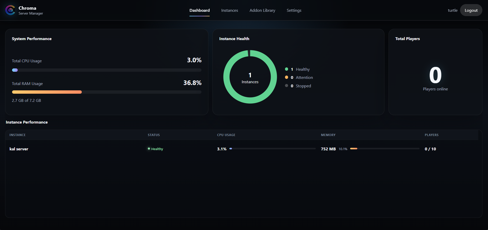
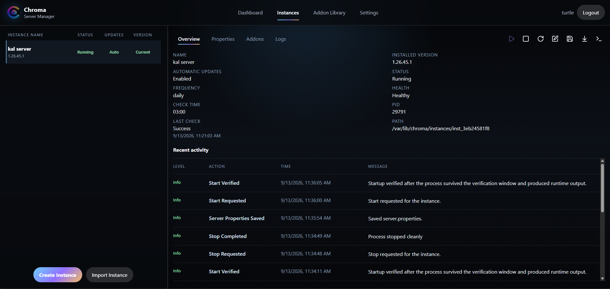
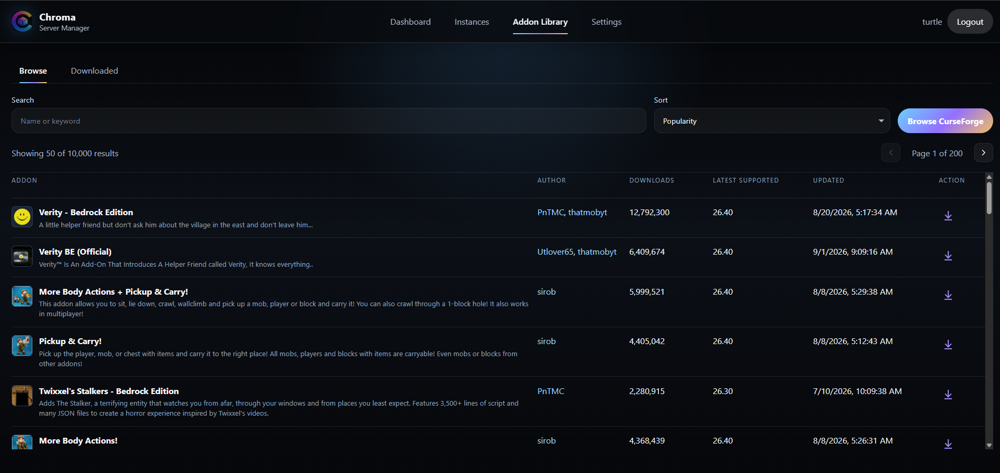
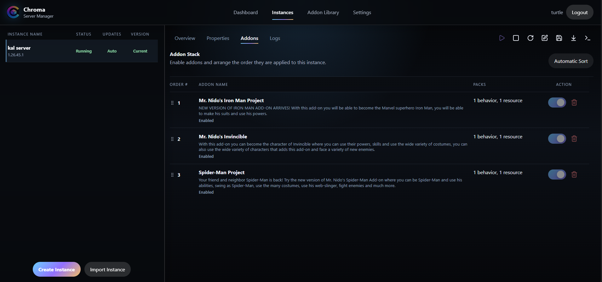
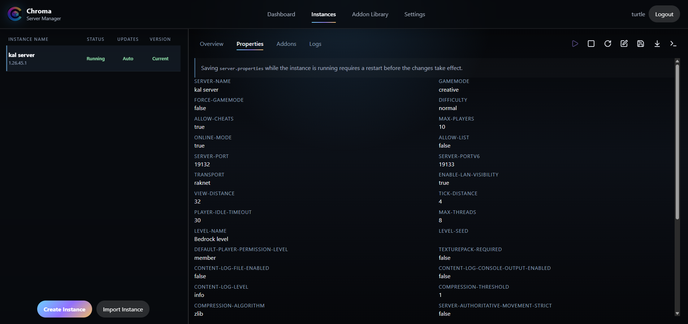
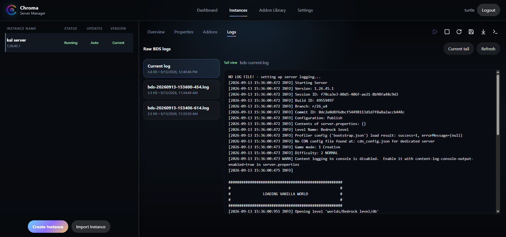
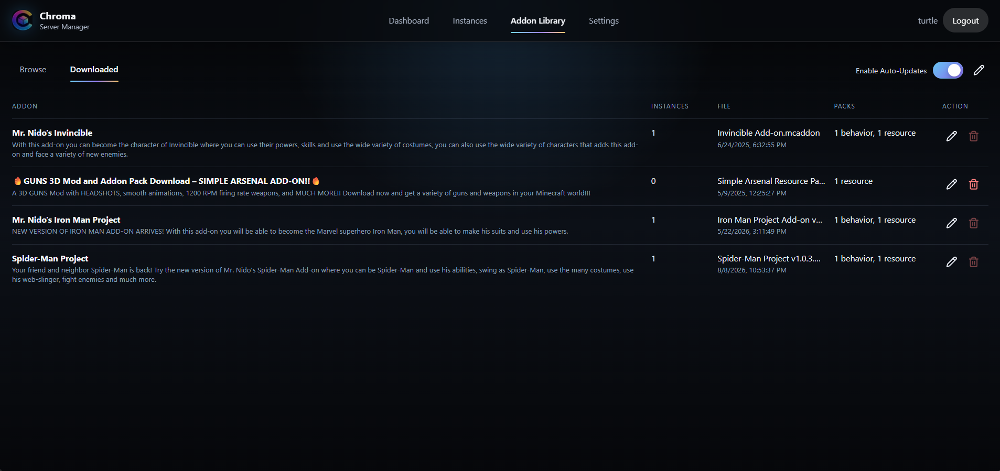
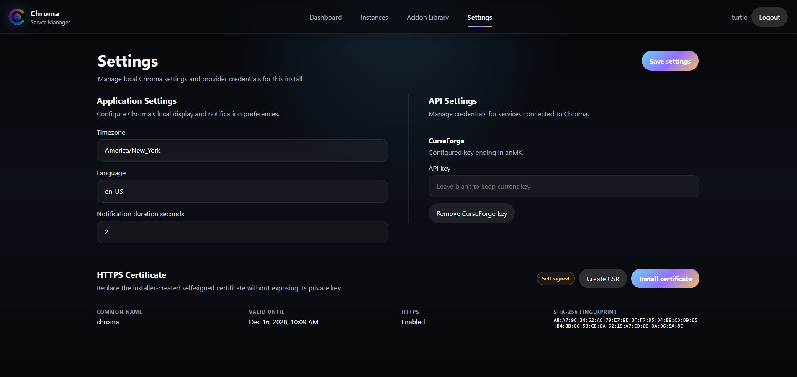

<p align="center">
  
</p>

<h1 align="center">Chroma Server Manager</h1>

<p align="center">
  Deploy, manage, and mod multiple Minecraft Bedrock servers from one WebUI.
</p>

<p align="center">
  <a href="docs/how-to/README.md"><strong>Installation &amp; management guide</strong></a>
  &nbsp;·&nbsp;
  <a href="https://github.com/Nerd-Turtle/Chroma/releases">Releases</a>
  &nbsp;·&nbsp;
  <a href="https://github.com/Nerd-Turtle/Chroma/issues">Report an issue</a>
</p>

Chroma is a self-hosted web application for managing Minecraft Bedrock Dedicated
Servers that provides integrated CurseForge Addon support. Create an Instance, configure the server, choose its
addons, and monitor its activity and performance from one location.



## An Instance for every server

Keep a survival world, a creative playground, and an addon test server in separate
instances. Each instance has its own Bedrock installation, settings, worlds,
addon configuration, logs, and backups.

- **Create and control instances.** Install the latest Bedrock server during
  creation, then start, stop, and restart it from the workspace.
- **See what is happening.** Follow instance health, installed versions, update
  status, and recent activity alongside host and instance resource usage.
- **Choose when to update.** Check for Bedrock updates manually or configure
  daily or weekly automatic updates for each instance. Download stable addon
  releases centrally, then let each instance adopt compatible versions on its
  own schedule once stopped.



## Discover addons. Build your own stack.

Browse CurseForge inside Chroma, search by name or keyword, and explore addons
by author. Download addons to the library, then choose which instances use them.
CurseForge browsing and downloads require your own API key, configured in Settings.

Downloading, linking, and enabling are separate steps. Each instance controls its
enabled addons and their order, with drag-to-reorder controls, automatic sorting,
and dependency feedback to help manage the stack.





## The tools you need, in your browser

| Capability | What you can do |
| --- | --- |
| Server properties | Review Bedrock settings and edit `server.properties` through the built-in editor. |
| Logs and console | Read current and historical logs, stream console output, and send Bedrock commands. |
| Backup and import | Download a full instance backup and import a Chroma backup as a separate instance. |
| Addon library | Organize downloaded packs, inspect their contents, and manage links to instances. |
| Application settings | Set timezone and notification preferences, manage the CurseForge key, and generate a CSR or install an HTTPS certificate. |

<details>
<summary><strong>Take a closer look: properties, logs, library, and settings</strong></summary>

### Server properties



### Logs



### Downloaded addons



### Chroma settings



</details>

## Run Chroma on Ubuntu

Chroma runs directly on Ubuntu 24.04 and 26.04 AMD64 hosts, using a systemd
service and one shared application package with a bundled Node.js runtime.
Docker installation is not currently supported.

Install the latest stable release with the installer:

```bash
chroma_installer="$(mktemp)"
curl --fail --show-error --silent --location \
  https://github.com/Nerd-Turtle/Chroma/releases/latest/download/install-chroma.sh \
  --output "${chroma_installer}" && sudo bash "${chroma_installer}"
```

Under **Settings → Chroma Updates**, Chroma checks GitHub for stable releases.
The default is to notify you. Automatic installation is optional and waits until
every Minecraft instance is stopped.

**[Read the installation and management guide →](docs/how-to/README.md)**

Chroma is still in early development. I'd advise you to keep copies
of important worlds, and read the guide's deployment notes before installing.

## About the project

As a gamer Dad who loves to play Minecraft with his kids, I found myself spending
more time managing and troubleshooting our families Bedrock Dedicated Servers
then actually playing on the with my kiddos.  I was inspired by the ease and
mod support integration of Prism Launcher for Java Minecraft, so I attempted to
build something similar for Bedrock.  Chroma was designed to provide a simple
Dedicated Bedrock Server management UI, while also integrating and automating the
installation of Addons.  Chroma is a vibecoded project using ChatGPT & Codex,
built with TypeScript, React, Fastify, and SQLite.  Please feel free to roast,
provide constructive feedback, or directly contribute to the project!

See the [development notes](dev/README.md) to explore the project locally.

Chroma Server Manager is licensed under the [MIT License](LICENSE).
