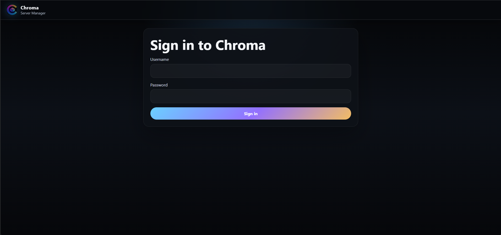
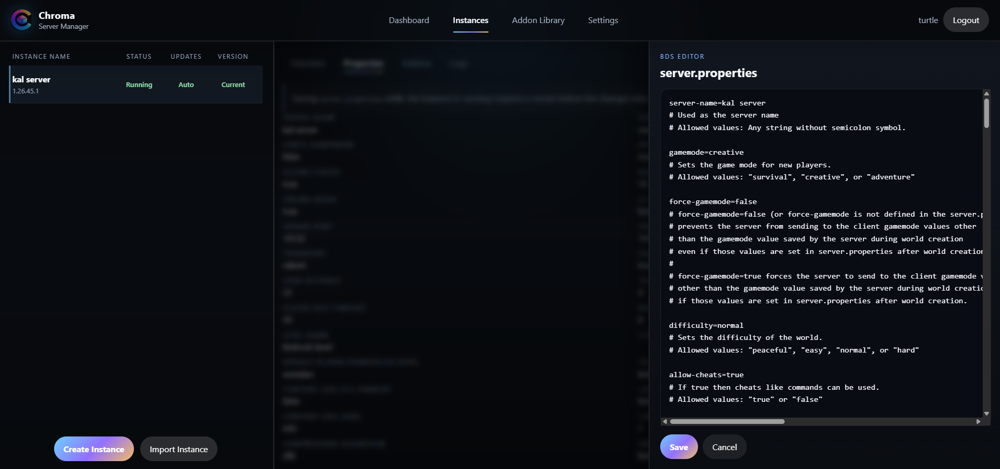
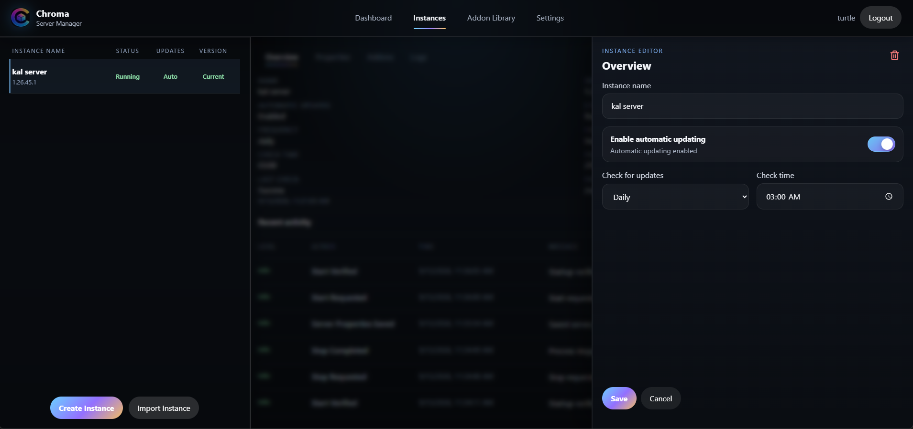
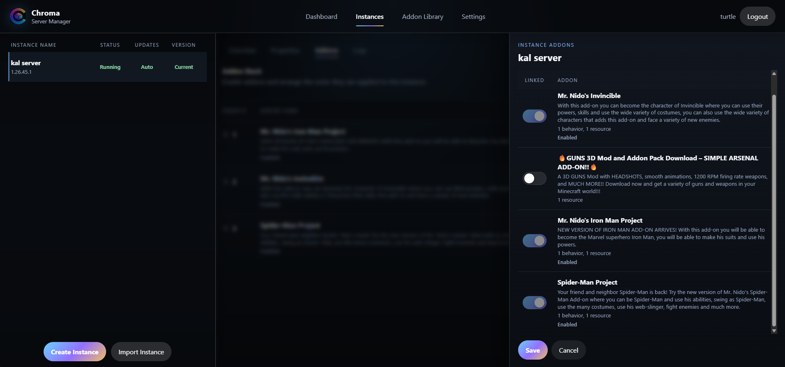

# Install and manage Chroma

[← Chroma Server Manager](../../README.md)

This guide covers installing Chroma on Ubuntu and managing Bedrock servers
through its web interface. For building Chroma from source, use the
[development notes](../../dev/README.md) and
[release packaging notes](../../install/ubuntu/README.md).

## Contents

- [Before you install](#before-you-install)
- [Install Chroma](#install-chroma)
- [First sign-in](#first-sign-in)
- [Create your first instance](#create-your-first-instance)
- [Manage an instance](#manage-an-instance)
- [Addons](#addons)
- [Back up and import an instance](#back-up-and-import-an-instance)
- [Application settings and HTTPS](#application-settings-and-https)
- [Upgrade Chroma](#upgrade-chroma)
- [Service management and data locations](#service-management-and-data-locations)
- [Troubleshooting](#troubleshooting)

## Before you install

You need an Ubuntu **24.04 or 26.04 AMD64** host with systemd, sudo access,
internet access for downloads, and storage for your worlds, addons, and backups.
The release includes Node.js and application dependencies; the target host does
not need Git, pnpm, or a compiler. Docker and other host platforms are unsupported.

Chroma is in early development, with known security work still outstanding.
Keep the management interface on a trusted network; do not expose it directly
to the internet. Complete initial setup before giving other users network
access: a fresh installation currently allows the first visitor to create the
administrator account.

Check that the required ports are available:

| Purpose | Default ports | Protocol |
| --- | --- | --- |
| Chroma web interface | 443 | TCP |
| Redirect HTTP to HTTPS | 80 | TCP |
| Bedrock gameplay | 19132 (IPv4), 19133 (IPv6) | UDP |

Chroma does not configure your firewall or router. Allow management access only
from trusted clients, and allow players to reach the UDP ports configured for
their instance. Multiple instances need distinct port assignments. An existing
web server on ports 80 or 443 will conflict with the default installation.

## Install Chroma

For the latest stable release, download and run the installer:

```bash
chroma_installer="$(mktemp)"
curl --fail --show-error --silent --location \
  https://github.com/Nerd-Turtle/Chroma/releases/latest/download/install-chroma.sh \
  --output "${chroma_installer}" && sudo bash "${chroma_installer}"
```

The same script handles first installation, upgrades, and confirmed reinstalls.
To review the script or install a specific version, use the steps below.

Open [Chroma Releases](https://github.com/Nerd-Turtle/Chroma/releases) and choose
a release with `install-chroma.sh`, `chroma-ubuntu-amd64.tar.gz`, and its
matching `.sha256` file. The same package installs on Ubuntu 24.04 and 26.04.
These instructions require published release assets;
if none are available, the public installation path is not ready yet.

If curl is missing, install it first:

```bash
sudo apt-get update
sudo apt-get install --yes curl ca-certificates
```

Set `chroma_version` to the chosen release number without its leading `v`.
`0.1.0` below is an example, not a guarantee that this release is published.

```bash
chroma_version='0.1.0'
curl --fail --show-error --location \
  "https://github.com/Nerd-Turtle/Chroma/releases/download/v${chroma_version}/install-chroma.sh" \
  --output /tmp/install-chroma.sh
```

Continue only if the download succeeds. Review the downloaded script, then run
it using the same version:

```bash
less /tmp/install-chroma.sh
sudo bash /tmp/install-chroma.sh --version "${chroma_version}"
```

The installer validates the supported Ubuntu version, downloads the shared archive,
verifies its SHA-256 checksum, creates the `chroma` service account, installs the application,
generates an initial self-signed certificate, and enables and starts
`chroma.service`. It checks the service and local HTTPS health before reporting
success. Missing prerequisite Ubuntu packages are installed automatically.

## First sign-in

1. Open `https://YOUR-SERVER-IP/` from a browser on your trusted network.
2. Expect a certificate warning for the initial self-signed certificate. Verify
   you are connecting to your own host before proceeding. Access by IP can also
   produce a hostname mismatch with the initial certificate.
3. Complete setup with an administrator username, a strong password, timezone,
   and language preference. The CurseForge API key is optional at this stage.
4. Sign in with the account you created.



The Dashboard shows CPU and memory usage, instance health, and player counts.
Use **Instances** to create a server, **Addon Library** to browse and manage
downloaded addons, and **Settings** for application preferences.

Login cookies contain an opaque token generated from 32 cryptographically random
bytes (256 bits). Chroma stores only its SHA-256 hash in SQLite and keeps account
details on the server, following [OWASP's session token guidance](https://cheatsheetseries.owasp.org/cheatsheets/Session_Management_Cheat_Sheet.html#session-id-content-or-value).
Upgrading from a version that issued short `sess_` tokens requires signing in
again; those older cookies are no longer accepted.

## Create your first instance

1. Open **Instances → Create Instance**.
2. Choose a name and review the automatic update option. If enabled, choose a
   daily or weekly schedule and check time.
3. Submit the form and wait for the latest Bedrock Dedicated Server build to
   finish installing. New instances remain stopped after creation.
4. Select the instance and review **Properties**. Use **Edit server.properties**
   (the edit icon) to change settings such as game mode, difficulty, player limit,
   and UDP ports, then save.
5. Select **Start** and wait for the instance's runtime and health result.
6. In a Minecraft Bedrock client that supports adding servers, connect to the
   host's address and the instance's configured gameplay port.

Before starting another instance, give it distinct `server-port` and
`server-portv6` values. Read any startup validation feedback if Chroma blocks
the start.

## Manage an instance

Select an instance from the list to open its workspace. Hover over toolbar
icons to see their labels.

| Control or tab | Use |
| --- | --- |
| Start / Stop / Restart | Control the selected Bedrock server. |
| Overview | Review version, health, update schedule, and recent activity. |
| Edit overview | Rename the instance or change its automatic update schedule. |
| Properties | Review server settings; use the edit icon to open the text editor. |
| Addons | Manage enabled packs and their order. |
| Logs | Read the current tail or select a historical log. |
| Console | View live output and send Bedrock commands such as `help` or `list`. |
| Backup | Create and download a full instance backup ZIP. |
| Update options | Check for updates only, or check and install updates. |

### Change server properties

The built-in editor edits `server.properties` text inside the browser. Save
your changes, then restart a running instance for them to take effect. Export
a backup before significant world or configuration changes.



### Schedule Bedrock and addon updates

From **Overview**, open **Edit overview**. Enable or disable automatic updating
and set the daily or weekly schedule. Schedules use the timezone configured in
Chroma's application settings.



Installing a Bedrock update can interrupt players: Chroma stops an active
instance, creates an internal backup, updates BDS, and attempts to restart it.
Choose an appropriate maintenance time and check health and recent activity
afterward. Use **Update options → Check for updates only** when you want to
inspect availability without installing an update.

## Addons

Chroma distinguishes three states: an addon can be **downloaded** to the
library, **linked** to an instance, and **enabled** in that instance's world.

In order for CurseForge Addon support to work, you must first request an
API key, follow the instructions provided here: 
https://support.curseforge.com/support/solutions/articles/9000208346-about-the-curseforge-api-and-how-to-apply-for-a-key#key

### Browse and download

1. Enter your CurseForge API key in **Settings → API Settings** and save.
   Keep the key private; the UI shows only its configured state and a suffix.
2. Open **Addon Library → Browse**.
3. Search by name or keyword, choose a sort order, and select **Browse
   CurseForge**. Author links provide another way to explore results.
4. Use an addon's download icon, then open **Downloaded** to find it in the
   library. Downloading alone does not enable it on a server.

### Link, enable, and order

1. Select an instance and open **Addons**.
2. Open **Edit linked addons**, choose the downloaded addons to link, and save.
3. Use the switches in the addon stack to enable or disable linked addons.
4. Drag the order handles to arrange the stack, or use **Automatic Sort**.
   Read any dependency or compatibility feedback before proceeding.



Disable an addon before unlinking it. The Downloaded library also shows linked
instance counts and provides editing controls. An addon still in use cannot
simply be deleted from the library.

### Schedule addon updates

In **Addon Library → Downloaded**, enable **Download updates automatically**
and use the pencil icon to choose a daily or weekly library schedule. Chroma
checks CurseForge and downloads the latest available stable releases once into
the central library. **Check and download updates** runs that check manually.
Both schedules use the timezone configured in Chroma Settings.

Instances adopt downloaded releases on their own daily or weekly update
schedule, configured under **Overview → Edit overview**. Enable automatic
Bedrock and addon updates there, then use each library release's **Edit addon
links → Linked Instances → Auto Update** preference to choose which addons
may advance. Turn that preference off to pin an instance to its current addon
version. Disabling the library schedule stops automatic downloads; instance
schedules can still adopt releases already downloaded.

Running or busy instances wait until stopped and idle. An addon update alone
does not stop or start a Minecraft server. If a scheduled Bedrock update already
stops the instance, eligible addons can update before its normal restart.
Chroma creates an internal world/configuration backup, preserves addon
enablement and stack order, and retains older library releases. Files still
referenced by instances or pending updates cannot be deleted from the library.

Review **Library updates** or an instance's **Scheduled addon updates** panel
for pending work and errors. Unconfirmed Bedrock compatibility, changed pack
identities, missing checksums or dependencies, provider dependency/conflict rules,
and Script API dependencies are held for manual review. Coordinated updates across dependent addons require
manual management. These checks do not guarantee gameplay compatibility.

Failed updates restore the previous instance files and links where possible
and require **Retry update → Confirm retry**. Pending work survives a Chroma
restart. An interrupted update is recovered before instance starts are allowed;
if recovery fails, correct the reported filesystem issue before retrying.
Keep an export backup before manually changing an established world's addon
stack; automatic sorting does not guarantee that every combination works.

## Back up and import an instance

### Download a backup

Select an instance and choose **Backup** (the disk icon). Chroma creates a ZIP
containing the instance's Bedrock files, worlds, configuration, and addon data,
along with metadata needed for import, then starts the browser download.

For a running instance, Chroma warns players, briefly stops the server for the
backup, and attempts to restart it afterward. Check the final status if any
part fails. Store a copy of the downloaded ZIP away from the Chroma host.

### Import a Chroma backup

Choose **Import Instance** beneath the instance list and select a full backup
ZIP exported by Chroma. This creates a **new, stopped instance**; it does not
replace the existing instance. A standalone world ZIP is not a full Chroma
instance backup.

Review the imported name, UDP ports, and update schedule before starting it.
Imported ports may conflict with the original server. If Chroma reports addons
missing from the library, follow the UI's library synchronization workflow to
reconnect their future management and updates.

Instance exports do not replace a backup of the Chroma application database,
account settings, or HTTPS configuration. The installer's database backups are
also separate from instance exports.

## Application settings and HTTPS

Use **Settings** to change timezone, language preference, notification duration,
or the CurseForge API key. Save application settings after making changes.

For a certificate issued by your certificate authority:

1. Choose **Create CSR** and supply the requested certificate details, including
   the hostname clients will use.
2. Submit the generated CSR to your certificate authority.
3. Choose **Install certificate** and provide the issued PEM certificate and
   any required intermediate certificates.

Chroma reuses its existing private key, validates the supplied certificate,
backs up the previous certificate, and reloads the active TLS context for new
connections. The private key stays on the host. A certificate's names must
match how clients connect, and clients must trust its issuing authority.

## Upgrade Chroma

Chroma application upgrades are separate from Bedrock and addon updates.
Read the target release notes, save current instance exports, and back up
application data and configuration before upgrading.

Open **Settings → Chroma Updates** to manage application updates:

- Automatic checks are enabled by default, every 24 hours. You can choose 6,
  12, or 24 hours, or disable automatic checks and use **Check for updates**.
- **Notify only** is the default. An available update appears in the navigation
  bar and in Settings, with a link to the release notes.
- **Install automatically** waits until all Minecraft instances are stopped and
  their maintenance tasks have finished. A waiting update is reconsidered every
  minute without repeatedly querying GitHub.
- **Install update** provides a confirmation step for an immediate upgrade.
  All Minecraft instances must be stopped first. Chroma blocks new instance
  starts during the upgrade and reconnects the Settings page after restarting.

Only stable releases tagged `vMAJOR.MINOR.PATCH` are considered. The shared Ubuntu
AMD64 archive and its checksum must both be published. Prereleases and
downgrades are excluded. Update checks do not require a GitHub API key.

WebUI installation requires the updater service supplied by the Ubuntu installer.
For an older installation, run the installer for the first release supporting
WebUI upgrades once. Source checkouts can check for updates but do not install
application releases from the UI.

The upgrade runs in its own systemd service, so it can finish while Chroma is
stopped. It verifies the release checksum, retains the previous application
release, backs up the stopped application's database, and checks the service's
HTTPS health after startup. A failed automatic upgrade requires a manual retry;
Chroma does not repeatedly reinstall the same failed version or automatically
roll back a database that may already have been migrated.

For command-line upgrades, repeat the [installation download and run steps](#install-chroma) with the new
release version and that release's installer. Plan downtime: stopping Chroma
also stops its managed Bedrock processes. After the upgrade, sign in and check
each instance before starting the servers you want to run.

| Selected release | Installer behavior |
| --- | --- |
| Newer | Upgrade, preserving existing configuration and data. |
| Same version | Ask whether to reinstall; the default is No. |
| Older | Reject the downgrade before stopping the service. |

The installer retains previous release directories and creates a database
backup under `/var/lib/chroma/backups/installer`. It does **not** automatically
roll back after activating a new release, because database migrations may
already have run. Do not switch the application symlink back without checking
database compatibility and the release's recovery instructions.

## Service management and data locations

Inspect the Chroma service and its logs:

```bash
sudo systemctl status chroma.service
sudo journalctl -u chroma.service -n 100 --no-pager
```

Use the command for the operation you need; these are separate actions:

```bash
sudo systemctl start chroma.service    # Start Chroma
sudo systemctl stop chroma.service     # Stop Chroma and managed Bedrock servers
sudo systemctl restart chroma.service  # Restart Chroma
```

These commands affect the Chroma application. Use the web UI's instance
controls for routine Bedrock operations. Stopping or restarting Chroma also
stops managed Bedrock processes; check and start the desired instances afterward.

| Location | Contents |
| --- | --- |
| `/opt/chroma` | Application releases and the `current` release symlink. |
| `/etc/chroma` | Service configuration and HTTPS material. |
| `/var/lib/chroma` | SQLite database, instances, addons, and backups. |
| `/var/log/chroma` | Application log storage; systemd output is available through `journalctl`. |

The service environment file is `/etc/chroma/chroma.env`; HTTPS files are in
`/etc/chroma/pki`. Development uses a separate `.runtime` directory as described
in the [development notes](../../dev/README.md).

## Troubleshooting

| Symptom | Check |
| --- | --- |
| Installer download returns 404 | Confirm the release tag, installer asset, shared Ubuntu AMD64 archive, and checksum have been published. |
| Web interface is unreachable | Check service status, address, firewall, and whether another service occupies TCP 80 or 443. |
| Browser certificate warning | The initial certificate is self-signed; check the hostname and install a certificate trusted by your clients. |
| Instance will not start | Read Overview feedback and Logs; check installation state, UDP port conflicts, and addon errors. |
| Players cannot connect | Confirm Bedrock client compatibility, the instance's address and UDP port, and firewall/router rules. |
| Property changes have no effect | Save the editor, then restart the instance. |
| CurseForge browsing is unavailable | Check provider status and the API key in Settings, then network access from the host. Never include the key in a bug report. |
| Backup or update fails | Review recent activity and logs, free disk space, and the final instance state before retrying. |

For a bug report, include your Chroma version, Ubuntu version, the steps to
reproduce, and relevant redacted logs in
[GitHub Issues](https://github.com/Nerd-Turtle/Chroma/issues). Omit passwords,
provider keys, session cookies, and private certificate keys.
